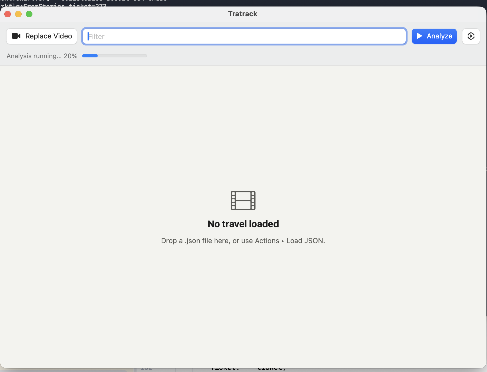
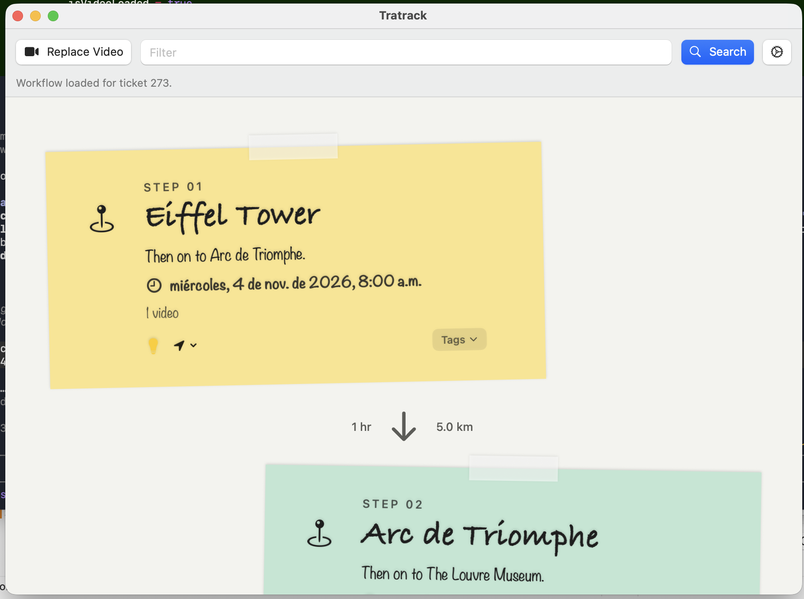
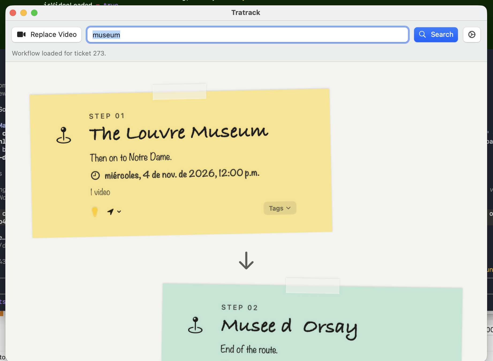
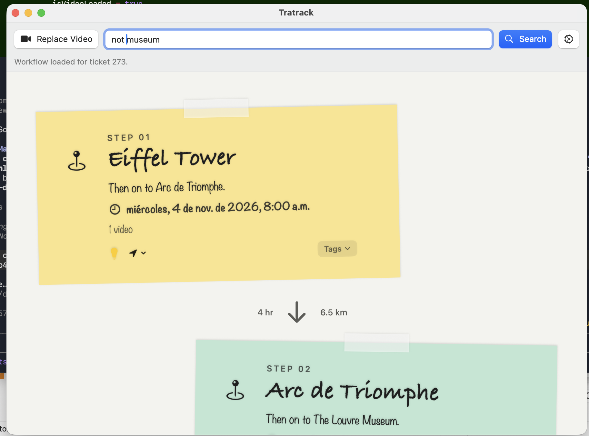
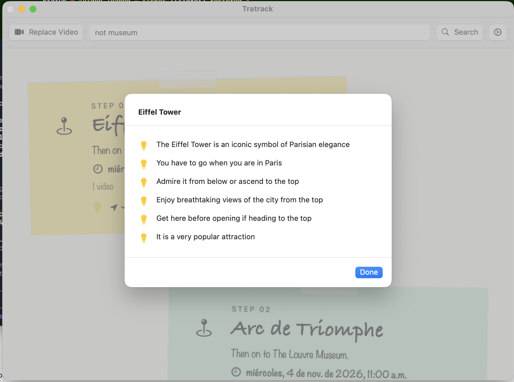
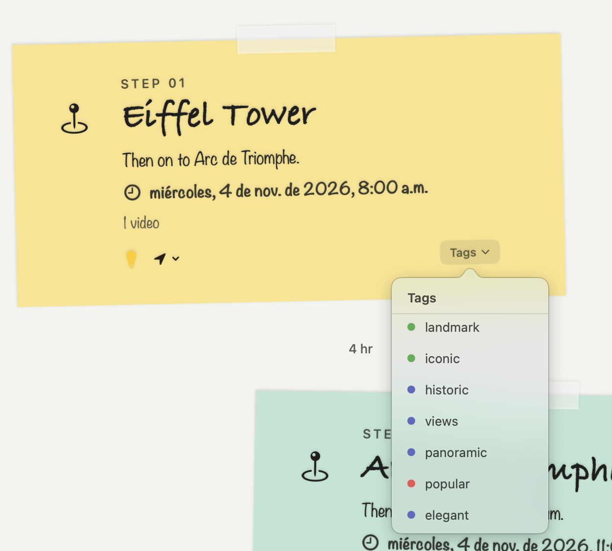
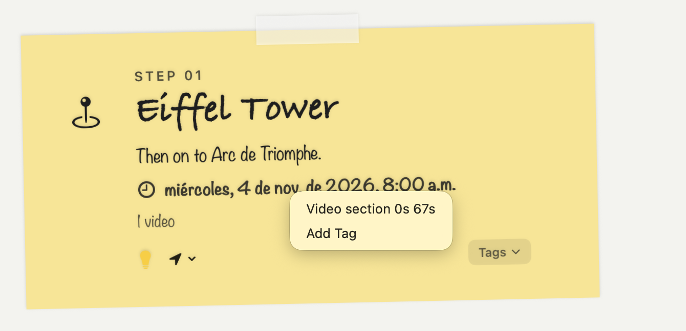
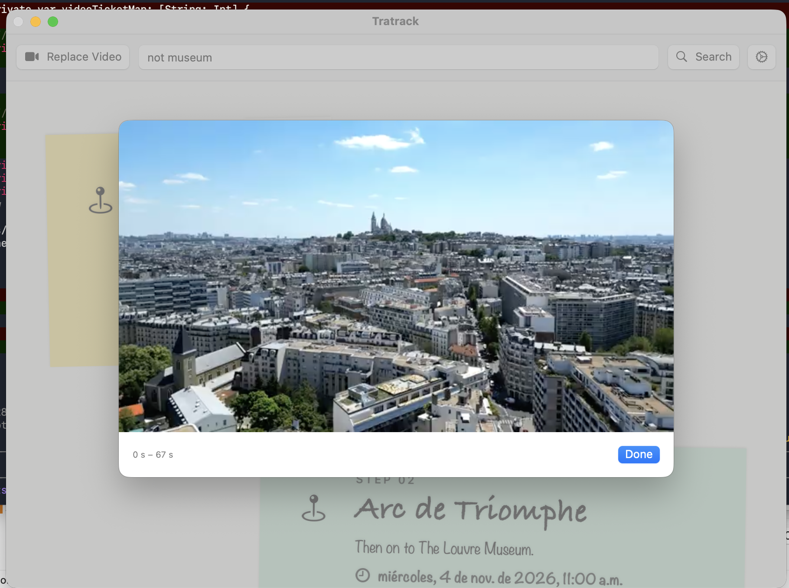
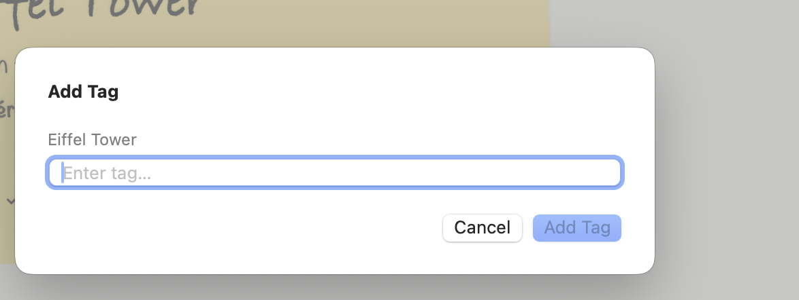
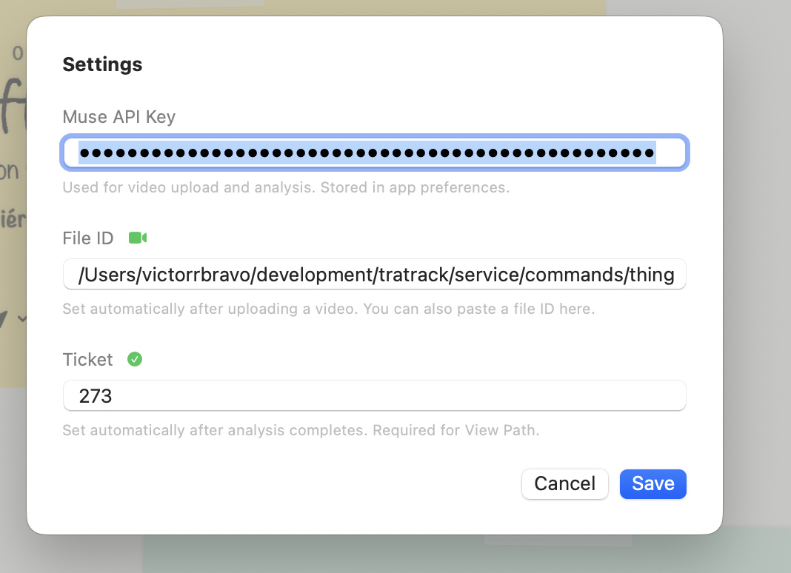

# TraTrack

> **Travel smarter. Spend less. Enjoy more.**

Whenever you travel to a new destination, it's hard to know how far apart the attractions are, what you'll find at each one, or whether it's worth visiting. Watching travel videos helps — but then you have to take notes, research every place, and organize everything yourself. That's exhausting.

**TraTrack** solves this by analyzing any travel video with Muse AI and automatically extracting all the relevant information — places, times, distances, tips, tags, and video segments — organized into a clean, easy-to-read canvas. In just a few minutes, your next trip is planned.

---

## Screenshots

### Analyzing a video

Upload an MP4, hit Analyze, and watch the progress bar as the AI processes the video. Results are pushed in real time via gRPC.



---

### Travel canvas

Once analysis is complete, each place appears as a handwritten sticky note. Notes show the step name, description, date and time, travel time and distance to the next stop, and attached video count.



---

### Filter by keyword

Type any keyword in the Filter field and hit Search to narrow the canvas to matching steps — for example, `museum` shows only museum stops.



Negation and other terms work too — `not museum` shows everything else.



---

### Tips

Click the lightbulb icon on any step to load AI-generated tips for that place.



---

### Tags

Each step carries color-coded tags extracted from the video. Click **Tags** to see them in a popover.



---

### Video segments

Right-click any step and choose **Video section** to jump directly to that moment in the original video.





---

### Add a tag

Right-click any step and choose **Add Tag** to annotate it with a custom label. The tag is saved to the database immediately.



---

### Settings

Configure your Muse API key, video file ID, and ticket number. These are saved automatically after each successful analysis.



---

## How it works

TraTrack has two components:

### Go service (`service/`)

A backend written in Go that exposes a **gRPC interface** with three main operations:

- **StartAnalysis** — accepts a Meta Muse AI file ID, runs a multi-step AI pipeline (places → tips → durations → locations → database), and returns a job ID immediately.
- **SubscribeAnalysis** — streams real-time progress events (0–100 %) and delivers the final JSON result when the job completes.
- **CallStories** — queries the stories-service database to retrieve and filter the saved travel flow.

### macOS app (`macos-app/`)

A native Swift app for macOS that:

1. Uploads an MP4 video (≤ 50 MB) to the Meta Muse AI Files API, or loads it locally for video-segment playback.
2. Calls **Analyze** and shows a live progress bar while the service runs.
3. When complete, the ticket number is saved automatically and associated with the video filename for instant recall on future loads.
4. Loads the travel canvas via **Search** (with optional keyword filter).
5. Lets you explore each step — tips, tags, map location, video segments — and annotate steps with new tags.

---

## Quick start

### 1. PostgreSQL

```bash
# macOS
brew install postgresql@16 && brew services start postgresql@16

# Create user and database
psql postgres -c "CREATE USER stories WITH PASSWORD 'stories';"
psql postgres -c "CREATE DATABASE stories OWNER stories;"
psql -U stories -d stories -f service/data/stories.sql
```

### 2. Go service

```bash
cp service/.env.example service/.env
# Edit .env — set MODEL_API_KEY to your Muse API key
cd service
go run ./cmd/server
# gRPC server listening on :50051
```

### 3. macOS app

```bash
cd macos-app
swift run
```

Open **Settings** (gear icon) and enter your **Muse API key**. Then click **Upload Video** to get started.

---

## Key environment variables

| Variable | Default | Description |
|---|---|---|
| `GRPC_ADDR` | `:50051` | gRPC listen address |
| `MODEL_API_KEY` | — | Muse API key (required for real analysis) |
| `DB_HOST` | `localhost` | PostgreSQL host |
| `DB_NAME` | `stories` | PostgreSQL database |
| `DB_USER` / `DB_PASS` | `stories` | PostgreSQL credentials |
| `ANALYSIS_DURATION` | `5m` | Simulated duration (set to `10s` for demos) |
| `ANALYSIS_LOCATION` | `Paris` | City used for geocoding |

---

## License

### Code

This project is licensed under the **Creative Commons Attribution 4.0 International License (CC BY 4.0)**.

You are free to share and adapt the code for any purpose, provided you give appropriate credit.

[](https://creativecommons.org/licenses/by/4.0/)

### Media

All MP4 video files and media assets included in or distributed with this project are also licensed under the **Creative Commons Attribution 4.0 International License (CC BY 4.0)**.

See [https://creativecommons.org/licenses/by/4.0/](https://creativecommons.org/licenses/by/4.0/) for the full license text.
